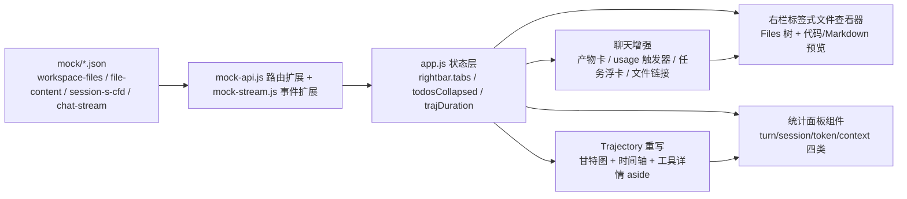

## 产品概述

基于本地页面 DeepSeek Harness（http://127.0.0.1:3080）的【CFD流线圈空白问题排查】会话，对已完成复刻的 `g:/dsh/dsh-ui-replica` 静态工程补齐 7 个 UI 细节，全部交互由 mock JSON 数据驱动，可离线测试。

## 核心功能（7 个待复刻细节）

1. **右栏多标签文件查看器**：右栏从单一 Start 面板改为标签式面板（标签条 + Files/文件标签），可同时打开多个文件（标签高 28px、圆角 8px、激活底色 #F1F3F5、20x20 关闭钮、chrome 区布局/最大化/收起按钮）；点击对话中的文件路径链接也在右栏开新标签
2. **对话产物卡片**：助手消息内嵌两个结果文件卡片（StreamlineDiag修复与测试报告.md、ChannelTest.vb）：344px 宽、圆角 16px、#FAFAFA 底、40x40 圆角 10 蓝色图标盒、13px/500 文件名 + 10px 灰色描述 + "Preview in sidebar" 提示 + 整卡预览按钮 + Show file location 拆分钮与 More ways 打开菜单；卡片下方消息操作区含"用量 63.7M tok"触发器、复制/反馈图标钮、结束时间
3. **四类统计详情面板**（统一 surface：rgba(248,249,250,0.58)、圆角 16、padding 16、三层阴影、minWidth 300）：Turn usage（Provider/model 等宽路由、Cache hit、Uncached/Cached input、Cache write、Output）、Session statistics（LLM time/Tool time/Avg TTFT/TPS）、Token usage（点底部 106M pill）、上下文用量（点 49%：堆叠条 4px 三段 System #ADB2B4/Tools #A78BFA/Messages #4D93F8 + swatch 行）；消息内用量触发器与底部 dock 三个 pill 均可点击弹出
4. **Trajectory 工具详情面板**：点击时间轴 TOOL 行弹出右侧 aside（白底、左边框、42px 头部：TOOL 琥珀标签 + Turn 2 · Step 140 + 关闭钮），五个标签【概览】【参数】【结果】【schema】【计时】：概览含 Hierarchy 导航链接与 Status 及四段折叠预览；参数为 JSON 树（可 Expand）；结果为等宽纯文本；schema 含工具名/描述/Parameters JSON 树；计时含 Started/Duration/Timing source
5. **可折叠任务列表浮卡**：对话上部悬浮卡片（rgba(248,249,250,0.58)、圆角 16、宽 344px）：头部列表图标 + "To-dos" + "8 completed" + chevron（aria-expanded 切换），展开为 8 条任务（10px done 圆点 + 13px 文本），可折叠/展开
6. **工作区文件树**：点击右栏"Workspace files"打开 Files 标签：38px 头部（路径 G:/Moira + Reload 钮）+ 树（行高 30px、圆角 12px、13px、文件夹/文件 16px 图标、chevron 展开收起），点击文件开预览标签
7. **Trajectory 时间轴**：替换现有柱状图为原页一致实现——工具栏（Duration 时钟开关/Actual time 开关/Turns/Calls 折叠钮/Search 输入）+ 甘特图（高 50px、Input/Model/Tools 三车道标签、span 高 8px：工具纯色 #DD8629、模型渐变 #BFB0D3→#8846AE 按 TTFT 分隔、输入蓝 #4D93F8、轮次分隔线、"…"更早历史钮）+ 时间轴表格（eventColumn 50px、行高 30px、边框 1px rgba(0,0,0,0.04)、TOOL 行琥珀标签+等宽 payload+→结果摘要、ASSISTANT 行 Request #N 边界钮+紫色标签+文本/(tool call only)、Load earlier history 行）

所有新组件必须同时支持浅色/深色主题（深色实测值：body #151517、侧栏 #1B1B1C、激活标签 #2C2C2E、卡片 #212123、kindTag 深色底 #27251F/#352F3A 等）。

## 技术栈

- 纯静态站点：HTML5 + CSS3 + 原生 JavaScript（ES5 风格，与现有 app.js 一致），零依赖零构建
- 数据模拟：mock/*.json + mock-api.js 拦截层（fetch/XHR 双兼容）+ mock-stream.js 脚本化流式引擎
- 本地运行：tools/serve.js（3081 端口，已在后台运行）

## 实现方案

### 数据层扩展（先行）

- 新增 `mock/workspace-files.json`：G:/Moira 文件树（嵌套 folder/file 节点，含 name/type/children，src 下到 CFDEngine/Eulerian 层级，与原页实测结构一致）
- 新增 `mock/file-content.json`：path → { lang, content }，含 README.md（Markdown 渲染）、StableFluidsSolver.vb（VB 代码，带行号与关键字高亮）、ChannelTest.vb、FlowVizSelfTest.vbproj（XML 高亮）四份内容
- 重写 `mock/session-s-cfd.json`：assistant 消息增加 `deliverables` 块（两个卡片 + note）、`todos`（8 条）、每轮 `usage`（turn usage 六字段）、`endInfo` 时间；trajectory 升级为事件数组（kind: tool/assistant、request 序号、工具名、payload、result、schema{name,desc,parameters}、timing{started,duration,source}、status、turn/step、起止百分比供甘特图使用）
- `mock/chat-stream.json` 增加 `deliverables`/`todos`/`usage` 事件类型；`mock-stream.js` 增加对应 handler 分发
- `mock-api.js` 增加路由：`GET mock/workspace-files.json`、`GET mock/file-content.json?path=<enc>`（query 解析）

### 视图层实现（复用现有模式）

- **通用菜单扩展**：openMenu 已支持富 HTML 面板（保存锚点 rect、点击外部/Esc 关闭），四类统计面板复用该 surface，新增 `panelHtml` 渲染入口
- **右栏标签化**：`state.rightbar = { tabs: [{id,kind:'files'|'file',path,name}], active }`；重写 `renderRightbar()`：标签条（标签+关闭+chrome）+ body 按 active 渲染 Files 树（k-1LKG 结构）或文件预览（dhJKeW 结构）；代码高亮新增轻量 tokenizer（vb/xml/md 关键字/字符串/注释/数字着色，行号列）；Markdown 复用 miniMarkdown；Workspace files 快捷卡片、对话文件链接、产物卡预览统一走 `openFileTab(path)`；标签关闭/切换/新建（+）走事件委托
- **聊天增强**：`renderMessage` 增加 `deliverables` 块渲染（nyYjTG 卡片 + note + 操作区）、usage 触发器（Q51KRG，点击开 Turn usage 面板）、endInfo 时间；新增 `renderTodos()` 浮卡（lXshSW，aria-expanded 折叠，状态存 `state.todosCollapsed`）；工具行中的文件路径渲染为可点击链接（开右栏标签）
- **统计面板**：新增 `openStatsPanel(anchor, kind)`，四种 builder 共用 dl 网格布局；dock 的 updateDock 三个 pill 分别绑定 session-stats / token-usage / context
- **Trajectory 重写**：`renderTrajectory()` 重写为三部分：工具栏（Duration 开关态 `state.trajDuration`、Turns/Calls 折叠过滤、Search 输入 120ms 防抖）、甘特图（labels 44px + track 内绝对定位 span，按事件 start/end 百分比，TTFT 渐变）、时间轴表格（tableLayout fixed，TOOL/ASSISTANT 行，Request #N 边界钮，Load earlier history 行，行点击委托）；新增 `renderToolDetails(ev)`：aside + 五标签（Summary/Payload/Result/Schema/Timing），JSON 树递归渲染（顶层展开、深层可 Expand），Timing 用 dl 布局；Esc/关闭钮移除 aside

### 设计决策

- **代码高亮零依赖**：正则 tokenizer 生成 span，颜色取自原页配色（关键字紫/字符串绿/注释灰/数字橙），避免引入 highlight.js
- **甘特图数据驱动**：事件起止百分比由 mock 数据提供（时间轴域归一化），避免运行时重排计算
- **虚拟滚动从简**：预置会话事件量级（数百行）用普通渲染 + CSS containment 足够，不引入虚拟列表框架，保持 KISS
- **图标补齐**：在 tools/gen-icons.js 的 PLUGIN_INLINE 风格区增补 folderOpen/clock/lineWrap/database/readAgain 等少量手写 SVG，重新生成 assets/icons.js（file/folder/newTab/split/fullscreen/collapseRight/todo/searchFiles/code/link/filePreview/fileLocation/otherPreview/gauge/track/refresh/close 已存在，直接复用）

### 性能与可靠性

- 右栏标签内容按激活标签渲染，非激活不渲染 DOM；文件内容 mock 一次缓存（state.fileCache）
- 消息流式渲染沿用现有增量逻辑，deliverables/todos 块仅在事件到达时追加
- JSON 读取失败沿用现有降级提示（toast），不阻塞 UI；所有新增交互错误进 window.__errors 便于排查

## 架构设计



## 目录结构（仅改动 g:/dsh/dsh-ui-replica/）

```
g:/dsh/dsh-ui-replica/
├── mock/
│   ├── workspace-files.json     # [NEW] G:/Moira 文件树数据（folder/file 嵌套节点）
│   ├── file-content.json        # [NEW] path→{lang,content}：README.md / StableFluidsSolver.vb / ChannelTest.vb / FlowVizSelfTest.vbproj
│   ├── session-s-cfd.json       # [MODIFY] 重写：deliverables 块、todos 8 条、每轮 usage、endInfo、丰富 trajectory 事件（含 payload/result/schema/timing/起止百分比）
│   ├── chat-stream.json         # [MODIFY] 增加 deliverables/todos/usage 事件类型
│   └── bootstrap.json           # 不变
├── assets/
│   ├── mock-api.js              # [MODIFY] 增加 workspace-files / file-content 路由（含 query 解析）
│   ├── mock-stream.js           # [MODIFY] 分发 deliverables/todos/usage 新事件
│   ├── icons.js                 # [MODIFY] 重新生成：增补 folderOpen/clock/lineWrap/database/readAgain 等缺失图标
│   ├── app.js                   # [MODIFY] renderRightbar 标签化重写；renderMessage 增 deliverables/usage/endInfo；新增 renderTodos/openStatsPanel/openFileTab/codeHighlight；renderTrajectory 重写（工具栏+甘特图+时间轴+工具详情 aside）；updateDock 绑定三类面板
│   └── replica.css              # [MODIFY] 新增分节：File viewer（标签/树/预览/代码高亮）、Deliverable cards、Usage panels、Tool details aside、To-dos card、Trajectory gantt/timeline；全部含 body[data-ds-dark-theme] 深色覆盖
└── tools/
    └── gen-icons.js             # [MODIFY] MAP/内联区增补缺失图标后重新生成 icons.js
```

## 执行注意事项

- 所有尺寸/颜色以实测值为准（标签 28px 圆角 8、卡片 344px 圆角 16 #FAFAFA、面板 surface rgba(248,249,250,0.58) 圆角 16、kindTag 19px 圆角 4、时间轴行 30px、甘特 span 8px 等），深色值一并落地
- 改动仅限本目录；mock 层保持先于 app.js 加载；不引入外部 CDN
- 每完成一个视图层任务即在浏览器自测，防止回归（现有侧边栏/hero/composer/聊天/设置/Plugins 功能不可破坏）

## 设计风格（新增组件的设计规格，全部对齐原页实测）

延续 DeepSeek Harness 浅色简洁工作台风格：白色主背景 + 浅灰侧边栏双色结构，新增组件统一复用既有令牌（主色 #4176E6、文字 #0F1115/#61666B/#81858C/#ADB2B4、边框 rgba(0,0,0,0.12)、表面 rgba(248,249,250,0.58)、圆角体系 8/10/12/16/999px），呈现干净、现代、专业的 AI 工作台质感。

### 右栏多标签文件查看器

- 标签条高 36px：文件标签高 28px、padding 0 10px、圆角 8px、13px #61666B，激活态背景 #F1F3F5 文字 #0F1115（深色 #2C2C2E/#F9FAFB），关闭钮 20x20 圆角 8 hover 显现；右侧 chrome 区（布局切换、最大化、收起）幽灵图标钮
- Files 树：头部 38px（路径 12px + Reload 28x28 圆角 8 钮）；树行高 30px、圆角 12px、13px，文件夹/文件 16px 图标 + chevron，缩进 12px/层，hover 淡背景
- 文件预览：头部 38px 面包屑 + 工具钮（Code/Line wrap/Auto refresh/Read again/Show file location 拆分钮 + More ways ▾）；代码视图等宽 12px、行号列 #ADB2B4、关键字 #A626A4 紫/字符串 #50A14F 绿/注释 #A0A1A7 灰/数字 #C18401 橙；Markdown 视图复用消息渲染样式
- 布局：右栏宽约 320px，标签内容区独立滚动

### 对话产物卡片

卡片 344px 宽、圆角 16px、#FAFAFA 底 + 1px rgba(0,0,0,0.04) 边、padding 8px 10px、flex gap 10px：40x40 圆角 10 图标盒（白 50% 底、#4176E6 图标）+ 文本列（fileName 13px/500、secondaryText 10px #81858C 两行截断、previewHint 10px）；整卡 hover 浮起细阴影；下方 note 10px 灰色；操作行：usage 触发器（12px #81858C、圆角 8、高 28px、图表图标）+ 复制/拇指 28x28 图标钮 + 右端 endInfo 时间 12px #81858C

### 四类统计面板

统一 surface：背景 rgba(248,249,250,0.58)（毛玻璃）、圆角 16px、padding 16px、minWidth 300px、阴影 `rgba(0,0,0,.04) 0 0 0 .5px, rgba(0,0,0,.04) 0 3px 8px, rgba(0,0,0,.05) 0 0 20px`；标题行 12px/500（label + value，gap 16）+ 1px 分隔线；dl 网格两列 gap 6px 16px（dt 12px #81858C 左对齐 / dd 12px #61666B 右对齐，等宽体用于路由）；上下文面板堆叠条 4px 圆角 999（三段占比色）+ swatch 行（8x8 圆角 2）

### Trajectory 工具详情 aside

白底（深色 #1B1B1C）、左边框 1px rgba(0,0,0,0.1)、flex column、宽约 40%：头部 42px（TOOL 琥珀标签 19px 圆角 4 + Turn/Step 11px #81858C + 关闭 28x28）；标签行 34px（五个标签 13px #4176E6、激活底部 2px 下边框）；内容区：概览 dl + 四段折叠 section（h3 13px/500 #61666B + chevron）；JSON 树等宽 12px（括号/字段名/字符串分色，深层折叠）；结果区 pre-wrap 等宽 12px 行高 19；Timing dl 三行

### 任务列表浮卡

宽 344px、背景 rgba(248,249,250,0.58)（深色 rgba(67,69,74,0.45)）、圆角 16px、padding 6px 12px：头部 24px（14px 列表图标 + "To-dos" 13px/500 + "8 completed" 13px #81858C + chevron，cursor pointer）；展开列表 flex column gap 8（item 20px：10px done 圆点 + 13px 文本，hover 无背景）；折叠/展开 150ms 高度过渡

### Trajectory 甘特图 + 时间轴

- 工具栏：Duration 时钟开关（12px #81858C、圆角 8、高 20px、aria-pressed 态主色淡底）、Turns/Calls ⊟ 折叠钮、Search 输入（放大镜 11px + 占位 12px）
- 甘特图高 50px + 底边框：左侧 44px 三行车道标签（Input/Model/Tools，10px #ADB2B4）；轨道内 span 高 8px 圆角 1px 绝对定位（工具 #DD8629 纯色、模型 #BFB0D3→#8846AE 渐变按 TTFT 分隔、输入 #4D93F8）；轮次分隔细线；左上 "…" 更早历史钮
- 时间轴表格：eventColumn 50px + contentColumn 弹性；行高 30px、单元格边框 1px rgba(0,0,0,0.04)（深色 rgba(255,255,255,0.06)）；TOOL 行琥珀标签 + 等宽工具名 + 等宽 payload 摘要 #61666B + "→" #ADB2B4 + 结果摘要；ASSISTANT 行 Request #N 边界钮 + 紫色标签（#8846AE on #EFE8F2）+ 文本或 "(tool call only)"；Load earlier history 行居中按钮

## Agent Extensions

### Skill

- **agent-browser**
- Purpose: 复刻完成后启动无头浏览器，将复刻页（http://127.0.0.1:3081）与原页（http://127.0.0.1:3080/?token=...）并排截图，对 7 个细节逐一对比验证：右栏多标签文件查看器（打开多个文件）、产物卡片、四类统计面板（Turn usage/Session stats/Token usage/上下文）、工具详情五标签面板、任务列表折叠展开、文件系统树、Trajectory 甘特图+时间轴；并模拟全部交互（开标签、关标签、点 pill、点工具行、折叠任务、搜索过滤）
- Expected outcome: 获得每个细节的原页/复刻页对比截图，输出差异清单并逐项修正，确保 7 个细节视觉与交互全部跑通且无回归