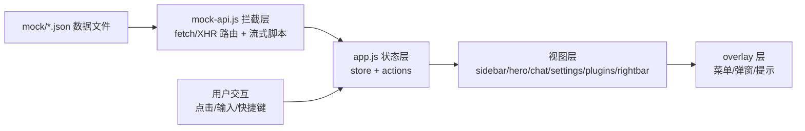

## 产品概述

复刻本地页面 DeepSeek Harness（AI 聊天工作台）的 UI 交互与视觉样式为纯 HTML+JavaScript 静态应用，并通过 JSON 文件模拟 XHR 请求/响应，使复刻界面全部操作可离线测试。

## 核心功能

- 三列式整体框架：左侧边栏（280px）、中心内容列、可折叠右侧边栏，支持菜单/弹窗覆盖层
- 左侧边栏：品牌 Logo 行、New Session 按钮（含快捷键提示）、Plugins 入口、Workspaces 工作区树（搜索过滤、展开收起、会话选择、会话/工作区操作菜单）、Settings 入口
- 空会话 Hero 视图："Into the Unknown" 主题标题、工作区选择芯片、模式选择芯片、大圆角输入卡片
- 输入区交互：`+` 触发菜单（File/Goal/Plan/Feedback）、访问权限下拉（Read Only/Workspace Write/Full access）、模型下拉（模型列表 + Effort 等级）、发送按钮
- 会话聊天视图：用户消息气泡（右侧蓝色气泡 + 时间 + 复制）、助手 Markdown 回复、可折叠活动分组（含工具调用行）、流式输出指示、底部统计 pills、Chat/Trajectory 双标签
- 设置弹窗：General/Models/Built-in plugins/Agent presets 四个分页，含权限、语言、外观（浅色/深色/系统切换）、字号等控件
- Plugins 页面：官方插件列表、Experimental 徽章、启用开关、添加插件按钮
- Mock 数据层：JSON 文件模拟全部数据接口，拦截 fetch/XHR，发送消息时按脚本化事件序列（思考→工具调用→文本分块→完成）流式返回，驱动界面完整交互测试

## 技术栈选择

- 纯静态站点：HTML5 + CSS3 + 原生 JavaScript（ES2020），零依赖、零构建，浏览器直接运行
- 数据模拟：`mock/*.json` 数据文件 + `assets/mock-api.js` 拦截层（同时兼容 `window.fetch` 与 `XMLHttpRequest`），含可配置延时的脚本化流式响应
- 本地运行：任选静态服务器（`python -m http.server 3080` 或 `npx serve`），README 说明
- 选型理由：原页面为 React SPA，复刻目标是"可测试的 UI 外观与交互"，原生 HTML/JS 最贴近用户要求、无构建链路、便于直接修改 JSON 测试数据

## 实现方案

单页应用外壳 + 状态驱动渲染，分三层：

1. **数据层**（mock-api.js）：拦截网络请求按 URL 路由到 `mock/*.json`；`POST /api/sessions/{id}/messages` 返回脚本化流式事件序列（事件带 type/延时/payload），模拟思考→工具调用→逐段文本→完成的真实交互过程
2. **状态层**（app.js）：集中式 store（当前工作区、选中会话、消息列表、模型/模式/权限选择、主题、各面板开关），所有交互只改 state 后触发局部重渲染
3. **视图层**（app.js 渲染函数）：侧边栏、hero 视图、聊天视图、设置弹窗、Plugins 页、右侧边栏六个渲染单元按状态切换；菜单/弹窗统一走 overlay 层组件，点击外部关闭、Esc 关闭

关键决策：

- **菜单系统统一抽象**：原页所有下拉共用同一 surface 样式（半透明背景 + 圆角 + 阴影），封装通用 `openMenu(anchor, items)` 组件，模型子菜单、权限菜单、模式菜单、会话 ⋯ 菜单全部复用，避免重复代码
- **图标内联**：原页 SVG（鱼形 Logo、deepseek 词标、文件夹、chevron、发送箭头等）提取为 `icons.js` 字符串常量按需注入，保证 1:1 还原
- **主题用 CSS 变量**：light/dark 两套变量挂在 `body[data-ds-dark-theme]`，设置页切换即时生效，与原页机制一致
- **流式模拟可配置**：`chat-stream.json` 每个事件带 `delayMs`，便于调整测试节奏；流式期间发送按钮变停止态，统计 pills 实时累加

性能与可靠性：

- 消息列表按 id 增量追加，不做整列表重建；长会话只重渲染变化节点
- 事件委托处理列表点击（会话行、插件开关），避免海量监听器
- 搜索输入 120ms 防抖；JSON 读取失败有降级提示，不阻塞 UI

## 架构设计



## 目录结构

```
g:/dsh/dsh-ui-replica/
├── index.html                  # [NEW] 单页外壳：三列 frame + overlay 层 + 各视图挂载点
├── assets/
│   ├── replica.css             # [NEW] 全部复刻样式：设计令牌、组件样式、light/dark 主题变量
│   ├── icons.js                # [NEW] 从原页提取的内联 SVG 图标库（鱼形Logo、词标、文件夹、chevron、加号、发送、齿轮、复制、check 等）
│   ├── mock-api.js             # [NEW] 网络拦截层：路由 mock/*.json；fetch 与 XHR 双兼容；POST 消息返回脚本化流式事件
│   ├── app.js                  # [NEW] 状态管理 + 六大视图渲染 + 通用菜单组件 + 全部交互逻辑
│   └── mock-stream.js          # [NEW] 流式响应引擎：按事件序列延时推送，驱动打字机/工具调用/完成态
├── mock/
│   ├── bootstrap.json          # [NEW] 初始数据：工作区树、会话列表、模型、Effort、模式、权限、设置项、插件清单
│   ├── session-cfd.json        # [NEW] 预置会话完整聊天记录（用户消息+助手Markdown+活动分组+工具调用+统计）
│   └── chat-stream.json        # [NEW] 发送消息后的脚本化流式事件序列（含 delayMs）
└── README.md                   # [NEW] 运行方式、Mock 接口清单、测试操作指引
```

## 执行注意事项

- 所有尺寸/颜色以实测值为准（侧边栏 280px/#F9FAFB、卡片圆角 28px、主色 #4176E6、气泡 #EDF3FE），不凭感觉编造
- mock 层必须先于 app.js 加载，确保首屏渲染前拦截就位
- 深色主题变量需覆盖全部表面色，避免切换后出现白块
- 改动仅限本目录，不引入外部 CDN 依赖，保证离线可测

## 设计风格

完全复刻 DeepSeek Harness 的浅色简洁工作台风格：白色主背景 + 浅灰侧边栏的明亮双色结构，大圆角浮动卡片，克制的蓝色强调色，大量留白与细微分隔线，呈现干净、现代、专业的 AI 工作台质感。

## 布局架构

三列框架：左侧 280px 固定边栏（#F9FAFB）→ 中心弹性内容列 → 右侧可折叠面板（约 300px），顶部覆盖层承载菜单与弹窗。中心列两种状态：空会话为居中 Hero（标题+芯片+输入卡），有消息时为聊天流。输入卡片宽 712px、圆角 28px、三层柔和阴影，是视觉焦点。

## 关键视觉细节

- 侧边栏：Logo 行高 60px；New Session 白底圆角 12px 高 38px 带 kbd 快捷键；会话行高 32px、圆角 12px、淡灰底 rgba(38,49,72,0.06)，时间戳 10px 灰色
- 菜单体系：半透明 surface + 12px 圆角 + 阴影，item 高 28-36px，选中项右侧蓝色 check
- 消息流：用户气泡右对齐 #EDF3FE 圆角 20px；助手消息左对齐纯文本，活动分组可折叠（灰色标题+chevron），顶部灰色时长 pill
- 设置弹窗：左侧导航 + 右侧内容，Appearance 为三宫格卡片（Light 选中高亮边框）
- 微交互：hover 淡入背景、菜单缩放淡入、消息逐段打出、主题切换平滑过渡

## 响应式

以桌面端为主（原页为桌面工作台），最小支持 1024px 宽度；侧边栏可折叠为窄条，右侧栏可隐藏，保证窄屏下中心内容始终完整可用。

## Agent Extensions

### Skill

- **agent-browser**
- Purpose: 复刻完成后启动无头浏览器打开复刻页面，与原页面（http://127.0.0.1:3080）并排截图，逐视图（Hero/聊天/设置/Plugins）对比验证还原度，并模拟用户操作（点击菜单、发送消息、切换主题）确认交互可用
- Expected outcome: 获得复刻页与原页的视觉对比截图，输出差异清单并修正，确保交互流程全部可跑通